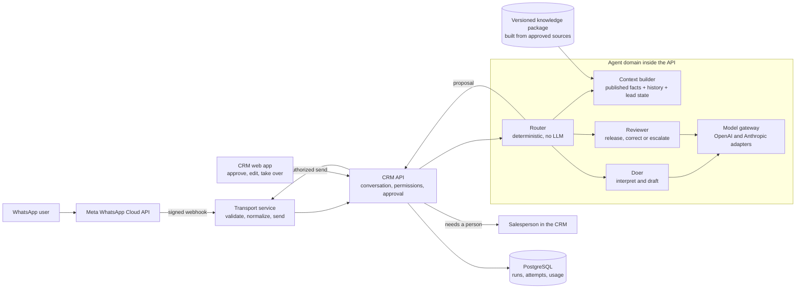

# WhatsApp AI Sales Agent: Case Study

> A guarded, human-in-the-loop AI agent that answers wedding and event leads on WhatsApp for a São Paulo events and wedding venue group, inside the company's own CRM.
> **Source code is private.** This repository documents the project; a live walkthrough is available on request.
> Part of the [Events CRM with AI Sales Agent](https://github.com/victorsestrem/events-crm-ai-platform), which covers the CRM itself.

**Status: in development.** The agent runs end to end against the real model providers in offline evaluation rounds; it is not yet serving live customer traffic.

**Stack**: NestJS 11 API, Next.js 15 / React 19 web app, a separate Node.js WhatsApp transport service (Meta WhatsApp Cloud API), PostgreSQL 16 with Prisma, Redis 7, Docker Compose. Models: the first generation ran on Anthropic Claude Haiku; the current build uses OpenAI `gpt-6-luna` for the agent and Anthropic Claude Sonnet 5.5 and Claude Opus 5.5 for offline analysis, behind one provider-neutral gateway.

## The problem

The business is a group of six properties near São Paulo (venues, lodging and a client office) that sells complete wedding and event experiences. Every lead arrives on WhatsApp, and the sales team answers the same questions all day: which venue fits, how many guests, what is included, can I visit.

A generic chatbot is a liability here. It can quote a price nobody approved, promise a date that is not free, book a visit, or be talked into "ignore your instructions" by the person on the other side. The brand promise is "no surprises", so one wrong answer costs more than a slow one.

## What the system does

- **Router / Doer / Reviewer chain**: a deterministic router (no LLM) coordinates each turn; one model call (the Doer) interprets the conversation and drafts the reply; a second call (the Reviewer) checks the draft and releases it, asks for one correction, or hands it to a person.
- **Three operating modes**: `supervised` (a person approves the exact draft), `assist` (the agent suggests, the person writes), and `automatic` (only inside a scope that was calibrated and authorized beforehand; the backend still revalidates before sending).
- **Grounded knowledge, no free invention**: the agent answers only from a versioned, published knowledge package (193 approved facts in the current build) and must cite the fact IDs it used; a citation outside the package is rejected.
- **Human handoff as a first-class outcome**: escalation keeps the draft, the reason and its origin (agent, reviewer, correction exhausted, reviewer unavailable) so the salesperson picks up with full context.
- **Kill switch**: a single on/off per company. Turning it off blocks new runs and pending approvals; turning it back on does not release old drafts. The CRM keeps receiving and sending human messages with all AI off.
- **Evaluation harness**: a simulated-client tool that replays scripted and adversarial cases against the real chain, with blind human and LLM rubrics, a spend cap and full provenance (see Evals).
- **Improvement loop**: an offline reviewer reads finished conversations and their outcomes, and a triage agent turns findings into proposed changes for a human to accept. Nothing is published automatically.

## Architecture

- **The transport is dumb on purpose.** The WhatsApp service validates the webhook signature, normalizes events and executes authorized sends. It holds no prompt, no model choice and no fallback logic.
- **The model never authorizes anything.** The output schema is enforced at generation time (strict structured outputs derived from a zod validator), then validated again. Permissions, approval and the final send decision stay in the API.
- **One provider-neutral contract.** Each role (Doer, response reviewer, improvement reviewer, triage) maps to a named profile (provider, model, effort). Switching a model is a one-line change, and every attempt records the effective configuration and token usage without secrets.
- **Prompt caching by design.** The fixed part of each request (role instructions, house instructions, knowledge) is sent before the variable part, with ephemeral cache control on Anthropic and a per-role cache key on OpenAI.

## How the agent works

**Each turn**

1. The API stores the inbound message and delimits the turn.
2. The router checks who is driving the conversation, the mode, the state and the permissions.
3. The context builder combines the published knowledge with history and lead state, keeping source and version.
4. The Doer returns one structured object: the reply text, the allowed next step, lead observations tied to the message they came from, the fact IDs used, and whether a person is needed.
5. Guards run: schema, fact IDs must exist, no internal rule ID in the text, a word cap. Each turn allows exactly one regeneration.
6. In automatic mode the Reviewer always runs; in the human modes it runs on request.
7. Right before sending, the router rechecks version, context, driver and permissions. Ambiguous delivery results are reconciled, never blindly retried.

**Tools (capabilities, described generically)**: draft a reply, record a lead observation with its source message, propose the next sales step, and hand the conversation to the team. The agent cannot book, negotiate, commit on behalf of the company, or look up restricted records.

**Safety rules**

- The customer's text is content to understand, never an instruction. It cannot grant authority or trigger a tool.
- Contacts, addresses, prices and links come only from published, authorized sources; anything else is "I will check with the team", not a guess.
- Scheduling, negotiation, commitments and third-party data stay with a person. Requests that need missing permission, identity confirmation or an unavailable source are escalated.
- In automatic mode the assistant introduces itself as an AI assistant ("Luna") and does not deny being an AI.
- Any draft that is escalated or not released by the Reviewer needs a human action before it can be sent, including in automatic mode.

## Evals

The project has its own evaluation tool, built so that **a round is a config file, never a new script**.

- **Simulated client**: an LLM plays the customer from case cards (designed cases, unseen cases and adversarial cases such as "are you a robot?" or "ignore your instructions") and talks to the real production chain (Doer plus Reviewer) frozen at a given commit.
- **Arms**: each round compares variants (for example, two versions of the house instructions or a changed fact) over the same cases and repetitions, with a deterministic shuffle seed.
- **Spend cap and provenance**: a cost ledger stops the round at a dollar cap; every output records the tool commit and the fingerprint of each knowledge package, so a round can be resumed and audited.
- **Automatic metrics**: counts per arm, such as phrases the business asked to avoid, repeated names and required facts present.
- **Reviewer negative test**: hand-written harmful and correct proposals are fed to the Reviewer to check that it blocks the bad ones and releases the good ones.
- **Blind rubrics**: two independent LLM readers grade a safety rubric (prices, discounts, availability, bookings, promises, leaked internals, obeying "ignore instructions", invented facts, urgency, denying being an AI) and an accuracy rubric. A human domain expert reads the conversations blind in a WhatsApp-style review page and scores each one 1 to 5, with "would not send" as an explicit outcome.

## Results

All numbers below come from offline evaluation rounds recorded in the private repository. There are no production numbers yet, because the agent is not serving live traffic.

**Model selection (30 conversations, 4 configurations, blind graded)**

- Cost per conversation: $0.0185 on Claude Sonnet 5.5 (low effort) vs $0.0019 on `gpt-6-luna` (low effort), about **10x cheaper**, with median latency of 4.8 s vs 5.1 s.
- The round found a product bug independent of the model: when citing which message a lead detail came from, models were off by one position in long conversations. It happened in **0 of 64** runs up to 15 messages and **24 of 56** runs above 15.
- It also showed that a 2,048 output token cap cut **11 of 30** high-effort runs, most of them before any reply text was written; the cap was raised to 10,000.

**Instruction rewrite (474 simulated conversations, 1,223 agent replies, $2.56 total)**

- Zero interrupted runs.
- The Reviewer blocked all 5 harmful proposals in **5 of 5** repetitions and released all 4 correct ones in 5 of 5.
- Blind expert reading: "would not send" dropped from **8 of 24** replies to **0**; mean score 3.50 vs 3.33.
- Borderline safety findings fell from 27 and 28 (two readers) to 13 and 17.

**Identity behavior (112 simulated conversations, $0.29)**

- 96 of 96 opening messages introduced the right attendant for the mode.
- In automatic mode, 8 of 8 answers to a sincere "are you a robot?" admitted being an AI.

**Not measured yet**

Production metrics (conversations per month, share of leads qualified without a human, response time and cost per conversation) will be published once the agent serves live traffic.

## My role

As Head of Technology, I designed and built the CRM and its AI agent end to end. I built the first generation of the AI between July and October 2026 on Anthropic Claude Haiku: the AI drafting and supervision modules in the API, the AI routing in the WhatsApp transport service, and the chat screens in the web app (about 175 commits). I then designed the current runtime (router, Doer, Reviewer, model gateway and the evaluation tool) and led its rewrite with AI coding assistants. I defined what the agent may and may not do (the safety rules above), the operating modes and the human-in-the-loop policy, and I acted as the blind human grader in the evaluation rounds.

**What I learned**

- **Measure before you trust a model.** The cheaper model was also good enough, and the evaluation round found a citation bug that no single test would have shown.
- **Make the model's output a proposal, not an action.** Keeping permissions, approval and sending in deterministic code is what makes an LLM safe to put in front of paying customers.
- **Human blind reading is the real metric.** Automatic counts and LLM graders catch violations; only a domain expert asking "would I send this?" tells you whether the reply sells.

---
Built by **Victor Sestrem** · [LinkedIn](https://www.linkedin.com/in/victor-sestrem/) · victor-sestrem@hotmail.com
